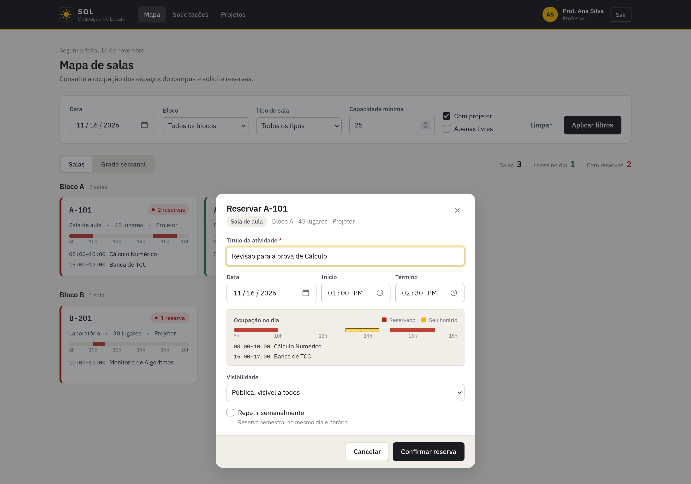
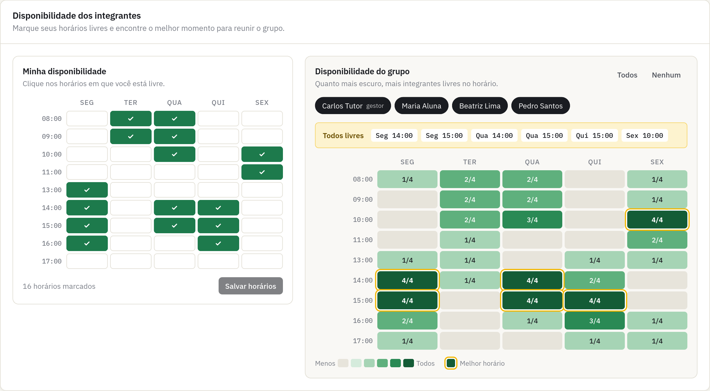

<div align="center">


# SOL: Sistema de Ocupação de Locais

Plataforma web de consulta e reserva de salas da **UTFPR, Campus Curitiba, Sede Centro**.


</div>

---

## Sobre o projeto

Hoje a reserva de salas no campus depende de e-mails e pedidos presenciais, sem visibilidade da ocupação real dos espaços. O SOL substitui esse processo por um sistema de autoatendimento: professores, tutores e alunos de projetos consultam a disponibilidade e fazem reservas sozinhos, e o Gestor de Salas mantém o controle sobre as solicitações que exigem aprovação.

O frontend está completo e funcional. Enquanto o backend em Spring Boot não fica pronto, os dados são persistidos no `localStorage` do navegador por uma camada de serviços que imita a API planejada.

## Capturas de tela

### Mapa de salas com filtros e reserva

Filtros por data, bloco, tipo, capacidade e projetor. Cada sala exibe a linha do tempo do dia; ao reservar, o modal mostra as reservas já existentes e o horário pretendido.



### Mapa de calor de disponibilidade de um projeto

Cada integrante marca seus horários livres. O mapa de calor cruza a disponibilidade do grupo, destaca os melhores horários e permite filtrar quais integrantes considerar.



## Funcionalidades

| Área | O que faz |
|------|-----------|
| Mapa de salas | Ocupação diária por bloco, filtros combináveis, linha do tempo por sala e grade semanal |
| Reservas | Reservas pontuais com aprovação automática quando a sala está livre; reservas semanais e salas de projeto seguem para o Gestor |
| Solicitações | Painel do Gestor para aprovar ou rejeitar reservas e projetos; demais perfis acompanham seus pedidos |
| Projetos | Cadastro com aprovação, gestão de integrantes, sala exclusiva e agenda de atividades públicas ou privadas |
| Disponibilidade | Marcação de horários livres e mapa de calor do grupo com sugestão de melhor horário |
| Administração | Cadastro de usuários, salas e disciplinas (somente Gestor) |

## Perfis de acesso

| Perfil | Permissões |
|--------|-----------|
| Gestor de Salas | Administração completa; aprova reservas semestrais e novos projetos |
| Professor | Reserva salas (pontual ou semestral) e registra projetos |
| Tutor | Gerencia a sala do próprio projeto, agenda atividades e coordena horários |
| Aluno | Consulta a ocupação; alunos integrantes de projetos acessam a área do projeto |

## Regras de negócio

- Salas de aula e laboratórios: reservas de um dia são aprovadas automaticamente se não houver conflito.
- Reservas recorrentes (semanais) ficam pendentes até a aprovação do Gestor.
- Salas de projeto: integrantes do projeto reservam com aprovação automática; demais usuários dependem do Gestor.
- Salas de departamento são exibidas no mapa, mas não aceitam reservas.
- Atividades privadas são visíveis apenas para quem as criou e para o Gestor.

## Como executar

Pré-requisito: Node.js 20 ou superior.

```bash
git clone https://github.com/Arthur-Heberle/SOL-Sistema-de-Ocupacao-de-Locais.git
cd SOL-Sistema-de-Ocupacao-de-Locais/frontend
npm install
npm run dev
```

A aplicação fica disponível em `http://localhost:5173`. A tela de login oferece acesso rápido a cada perfil de demonstração.

| Perfil | E-mail | Senha |
|--------|--------|-------|
| Gestor | `gestor@utfpr.edu.br` | `123456` |
| Professor | `ana@utfpr.edu.br` | `123456` |
| Tutor | `carlos@utfpr.edu.br` | `123456` |
| Aluna integrante de projeto | `maria@utfpr.edu.br` | `123456` |
| Aluno | `joao@utfpr.edu.br` | `123456` |

Para restaurar os dados de exemplo, limpe o `localStorage` do navegador (chaves com prefixo `sol.`).

### Scripts

| Comando | Descrição |
|---------|-----------|
| `npm run dev` | Servidor de desenvolvimento com recarga automática |
| `npm run build` | Verificação de tipos e build de produção em `dist/` |
| `npm run preview` | Serve o build de produção localmente |
| `npm run lint` | Análise estática com ESLint |

## Arquitetura

```
.
├── frontend/                 Aplicação React + TypeScript + Vite
│   └── src/
│       ├── components/       Componentes de domínio (mapa, calendário, modais)
│       │   └── ui/           Biblioteca de componentes base (Button, Modal, Table...)
│       ├── context/          Estado de autenticação
│       ├── pages/            Uma página por rota
│       ├── routes/           Rotas e proteção por perfil
│       ├── services/         Camada de dados (mock em localStorage)
│       ├── types/            DTOs compartilhados
│       └── utils/            Datas e rótulos
└── docs/
    ├── especificacao/        Plano do projeto (requisitos, casos de uso, dicionário de dados)
    ├── diagramas/            Diagramas UML em Mermaid
    └── img/                  Capturas de tela
```

Decisões principais:

- **Camada de serviços isolada.** Todas as páginas acessam dados apenas por `src/services/`. Trocar o mock pela API real exige alterar somente essa camada.
- **CSS Modules com design tokens.** Cores, raios e sombras são variáveis CSS definidas em `src/index.css`; cada componente tem seu próprio `*.module.css`.
- **Componentes acessíveis.** O modal usa o elemento nativo `<dialog>` com `showModal()`, e grades de horário e filtros usam controles nativos com rótulos.

## Roadmap

- [x] Frontend completo com dados simulados
- [ ] API REST em Java 17 + Spring Boot 3
- [ ] Persistência em PostgreSQL
- [ ] Autenticação JWT integrada ao login institucional
- [ ] Implantação na infraestrutura de TI da UTFPR

### API planejada

| Método | Rota | Descrição |
|--------|------|-----------|
| `POST` | `/auth/login` | Autenticação, retorna `AuthTokenDTO` |
| `GET` | `/salas` | Lista salas com filtros (`FiltroMapaDTO`) |
| `POST` | `/reservas` | Cria reserva |
| `PATCH` | `/reservas/:id/aprovar` | Gestor aprova reserva |
| `PATCH` | `/reservas/:id/rejeitar` | Gestor rejeita reserva |
| `GET` | `/reservas/pendentes` | Solicitações pendentes |
| `POST` | `/projetos` | Registra projeto (pendente de aprovação) |
| `GET` | `/disponibilidades/:idProjeto` | Interseção de horários livres do projeto |
| `POST` | `/disponibilidades` | Salva horários livres de um integrante |

## Documentação

- [Plano do projeto](docs/especificacao/plano-do-projeto.md): requisitos, casos de uso, dicionário de dados e regras de negócio
- [Diagramas UML](docs/diagramas/): classes, sequência, comunicação, estados e atividades

## Equipe

Projeto acadêmico desenvolvido na UTFPR, Campus Curitiba (2026).

- Arthur G. P. Heberle
- Luiz Henrique de Souza Correia
- Rafael de Andrade Fernandes
- Vinícius Romualdo Silva
